# Cezar Serafim 👋

Estudante de Análise e Desenvolvimento de Sistemas na PUCPR | Estagiário de TI na Equalize It Solutions (Curitiba, PR)

Sou um desenvolvedor em formação com experiência prática em suporte técnico de TI em ambiente corporativo e interesse em Cloud e desenvolvimento de software. Venho aprofundando meus conhecimentos em Java, Python e Inteligência Artificial por meio de projetos acadêmicos e cursos.

---

## 🔭 O que eu faço

- Estágio em TI na Equalize It Solutions: instalação e manutenção de equipamentos, atendimento de chamados e configuração de máquinas no padrão corporativo com Microsoft Entra ID.
- Experiência anterior na CONAB com suporte técnico N1 e gestão de ativos de TI no GLPI.
- Desenvolvimento de projetos acadêmicos em aplicações web, IoT e Machine Learning.
- Uso de ferramentas de IA (Gemini, ChatGPT e Claude) como apoio ao aprendizado e à resolução de problemas.

---

## 🛠️ Tecnologias & Ferramentas

Atualmente estou aprendendo:

- **Linguagens:** Java e Python
- **Web:** React.js e Firebase (Authentication, Firestore e Hosting)
- **Machine Learning:** Pandas, NumPy e Scikit-Learn
- **IoT:** ESP32, MicroPython e integração com dashboards (ThingSpeak)
- **Cloud:** fundamentos de Microsoft Azure
- **Ferramentas:** Git e Linux

---

## 🚀 Projetos em destaque

### 🌡️ [Monitoramento IoT com ESP32](https://github.com/cezarSerafim/esp32)

- **Descrição:** sistema embarcado com ESP32 e MicroPython para coleta de dados de umidade em tempo real.
- **Destaques:** leitura de sensor, conexão Wi-Fi, envio de dados para o ThingSpeak e dashboard para visualização remota.

### 📊 [Previsão de Win Shares da NBA](https://github.com/cezarSerafim/nba-machine-learning)

- **Descrição:** pipeline de Machine Learning para previsão de Win Shares de jogadores.
- **Tecnologias:** Python, Pandas, Scikit-Learn (Pipeline, SimpleImputer, SelectKBest e RandomForestRegressor).
- **Destaques:** divisão treino/teste antes da imputação para evitar vazamento de dados e análise crítica dos resultados.

### 🌐 [Aplicação Web com React e Firebase](https://github.com/cezarSerafim/projeto-react-firebase)

- **Descrição:** aplicação acadêmica com React.js no front-end, Firebase Authentication e Firestore no back-end.
- **Destaques:** roteamento com React Router, cadastro e login de usuários, dados vinculados ao UID e deploy no Firebase Hosting.

> Mais informações e código estão disponíveis nos repositórios deste perfil.

---

## 🎓 Formação

- Tecnologia em Análise e Desenvolvimento de Sistemas, PUCPR (cursando, 2025 – 2027)

**Cursos:**

- Introdução à Programação Orientada a Objetos (POO), Fundação Bradesco
- Aprendendo a aprender com a IA Generativa, PUCPR e Apple Developer Academy
- Fluência Digital e Tecnológica, Fundação Bradesco e Microsoft
- Inteligência Artificial para Pequenas e Médias Empresas, Fundação Bradesco e Microsoft

---

## 📫 Contato

- LinkedIn: [linkedin.com/in/cezarserafim](https://www.linkedin.com/in/cezarserafim)
- E-mail: [cezar1serafim@gmail.com](mailto:cezar1serafim@gmail.com)

---

  
  &nbsp;
  

---

<!-- Pacman -->
<picture>
  <source media="(prefers-color-scheme: dark)" srcset="https://raw.githubusercontent.com/cezarSerafim/cezarSerafim/output/pacman-contribution-graph-dark.svg">
  <source media="(prefers-color-scheme: light)" srcset="https://raw.githubusercontent.com/cezarSerafim/cezarSerafim/output/pacman-contribution-graph.svg">
  
</picture>
